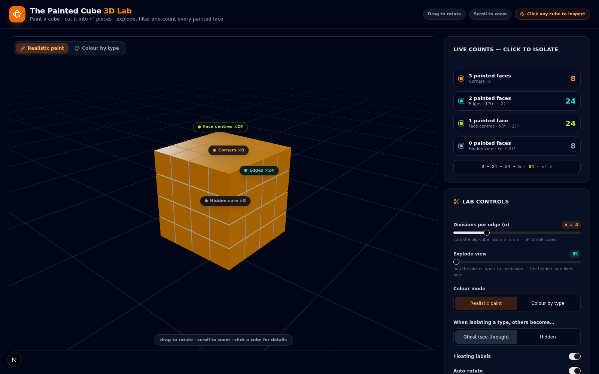
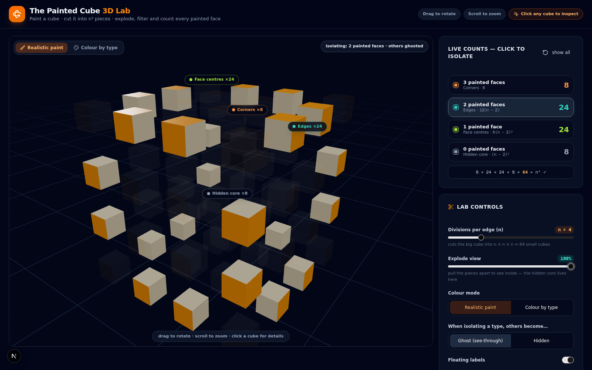

# The Painted Cube 3D Lab

An interactive 3D visualizer for the classic **painted cube problem**: paint the outside of a cube, cut it into n x n x n = n³ equal small cubes, then explode it apart and count exactly how many pieces have 3, 2, 1 or 0 painted faces.

Every number on the page is computed live from the actual geometry you see — nothing is hard-coded.



| Family | Where they live | Formula | For n = 4 |
| --- | --- | --- | --- |
| 3 painted faces | the 8 corners | `8` (always) | 8 |
| 2 painted faces | the 12 edges | `12(n − 2)` | 24 |
| 1 painted face | the 6 face centres | `6(n − 2)²` | 24 |
| 0 painted faces | the hidden core | `(n − 2)³` | 8 |

The golden identity — `8 + 12(n − 2) + 6(n − 2)² + (n − 2)³ = n³` — is verified live in the sidebar for every n.

---

## Requirements

| Tool | Version | Check with |
| --- | --- | --- |
| Node.js | 18 or newer (LTS recommended) | `node -v` |
| npm | ships with Node.js | `npm -v` |

Bun users can substitute `bun` for `npm run` everywhere (see below). No database, no API keys, no extra services are needed.

> One-time note: the app loads the Geist font from Google Fonts on first launch, so the very first page load needs internet. After that everything runs locally.

---

## Run it locally (3 steps)

**1. Unzip the project and open a terminal inside the project folder** (the folder that contains this README and `package.json`).

**2. Install dependencies** (one time only, downloads ~1–2 minutes):

```bash
npm install
```

**3. Start the dev server:**

```bash
npm run dev
```

Then open **http://localhost:3000** in your browser. You should see the painted cube rotating in 3D with the live counts panel on the right. The server hot-reloads, so you can edit any file under `src/` and the page updates instantly.

### Using Bun instead (optional, faster)

```bash
bun install
bun run dev
```

### Production build (optional)

```bash
npm run build
npm start        # serves the optimized build, still on http://localhost:3000
```

### Different port (if 3000 is taken)

```bash
npm run dev -- -p 3001
```

---

## How to use the lab



| Control | What it does |
| --- | --- |
| **Divisions per edge (n)** | Slider from 2 to 10 — rebuilds the big cube as n x n x n = n³ small cubes and updates every count and formula live. |
| **Explode view** | Pulls the pieces apart (0–100 %) so you can see the hidden core and count each family. |
| **Live counts panel** | Click any row (3 / 2 / 1 / 0 painted faces) to isolate that family; click *show all* to reset. |
| **Ghost / Hidden** | Chooses whether non-matching cubes become see-through or invisible while isolating. |
| **Realistic paint / Colour by type** | *Realistic paint* shows exactly which faces were painted orange; *Colour by type* repaints every cube by its family so the pattern jumps out. |
| **Click any small cube** | Opens the **Cube Inspector**: its grid address (x, y, z), which of its 6 faces are painted, and which family it belongs to. |
| **Floating labels** | Pins a chip over one example of each family (toggleable). |
| **Auto-rotate / Reset camera** | Keeps the model spinning or snaps the view back. |
| **Challenge yourself** | An endless quiz: for a random n it asks how many cubes have a given number of painted faces, checks your answer, and shows the full substitution. |

**Suggested demo flow for a classroom:** start at *Realistic paint* with n = 4 → slowly drag *Explode view* to 100 % → switch to *Colour by type* → click the *2 painted faces* row and count the 24 glowing edge cubes together.

---

## Project structure

```
painted-cube-3d-lab/
├── src/
│   ├── app/
│   │   ├── layout.tsx                  # fonts, metadata, dark theme
│   │   ├── page.tsx                    # page shell: header, canvas, side panel, footer
│   │   ├── globals.css                 # Tailwind 4 theme tokens
│   │   └── api/route.ts                # sample API route (not used by the lab)
│   ├── components/
│   │   ├── cube/
│   │   │   ├── PaintedCubeScene.tsx    # the 3D engine (react-three-fiber + drei)
│   │   │   ├── ControlPanel.tsx        # sliders, colour modes, live counts, inspector
│   │   │   ├── LearnSection.tsx        # the four family cards + golden identity
│   │   │   └── QuizCard.tsx            # endless practice quiz
│   │   └── ui/                         # shadcn/ui primitives (button, card, slider…)
│   ├── lib/
│   │   ├── cube.ts                     # all the painted-cube math (single source of truth)
│   │   └── utils.ts
│   └── hooks/
├── public/                             # static assets
├── docs/screenshots/                   # images used by this README
├── next.config.ts
├── tailwind.config.ts
├── package.json
└── bun.lock
```

The math lives in **`src/lib/cube.ts`** — `paintedCountOf()` counts painted faces for any small cube, `countsFor()` returns the four family counts for a given n, and every component reads from there, so the 3D view and the numbers can never disagree.

---

## Tech stack

- [Next.js](https://nextjs.org) (App Router) + React 19 + TypeScript
- [Three.js](https://threejs.org) via [@react-three/fiber](https://docs.pmnd.rs/react-three-fiber) and [drei](https://github.com/pmndrs/drei) (OrbitControls, infinite grid)
- [Tailwind CSS](https://tailwindcss.com) 4 + [shadcn/ui](https://ui.shadcn.com) components
- [lucide-react](https://lucide.dev) icons

---

## Troubleshooting

| Problem | Fix |
| --- | --- |
| `npm run dev` says `next: command not found` / `next is not recognized` | You skipped step 2 — run `npm install` first. |
| Port 3000 already in use | Run `npm run dev -- -p 3001` and open http://localhost:3001. |
| Node version error (Next.js 16 needs Node 18+) | Install the current Node.js LTS from https://nodejs.org. |
| 3D area stays black | WebGL is disabled or your GPU driver is outdated. Enable hardware acceleration in the browser settings (Chrome: `chrome://settings/system`) or try another browser. |
| Fonts look different / first load is slow offline | The Geist font is fetched from Google Fonts on first launch; with no internet the app falls back to system fonts and still works. |
| Installed with bun but prefer npm | Delete `node_modules` and `bun.lock`, then run `npm install`. |

**Browsers:** any recent Chrome, Edge, Firefox or Safari (WebGL 2 required).

---

## License

Released under the [MIT License](LICENSE). Three.js, Next.js and the other open-source packages keep their own licenses.
